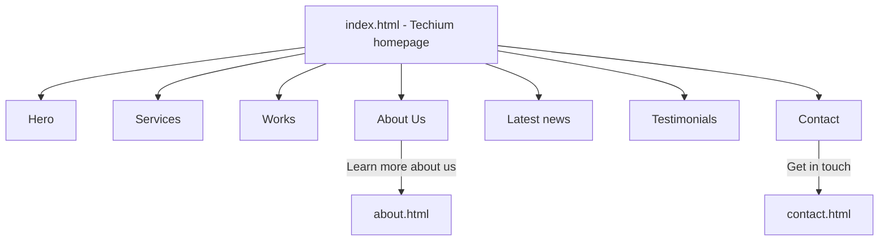

# Holberton School - Web Front End

Front-end projects from Holberton School: building web pages with HTML and CSS.

## Projects

| Folder | What is inside |
| --- | --- |
| [html_advanced](html_advanced/) | The **Techium** website (a fictional digital agency), built with HTML only |
| [CSS_advanced](CSS_advanced/) | CSS advanced project (work in progress) |
| [favicon](favicon/) | Shared icon files: `favicon.svg`, `apple-touch-icon.png`, web app icons and `site.webmanifest` |

## html_advanced - Techium

The homepage (`index.html`) is one page with these sections. It links to two other pages.



Other files in the folder:

- `article.html`, `latest_news.html`, `styleguide.html` - extra pages of the site
- Numbered files such as `0-index.html` or `11-styleguide.html` - the files for each task of the project
- `images/` - pictures used by the pages
- `logo-black.png`, `favicon.ico`, `favicon.png` - logo and icons

## Concepts practiced

- Page structure with semantic HTML (`header`, `nav`, `main`, `section`, `article`, `footer`)
- Links, images, lists and headings
- Page metadata and favicons
- Accessible images (`alt` text)

## How to view

Open an HTML file in your browser, for example:

```bash
open html_advanced/index.html
```

On Linux use `xdg-open`, or just double-click the file.

## Author

Arif Almusharafi - [GitHub](https://github.com/arif-almusharafi)
